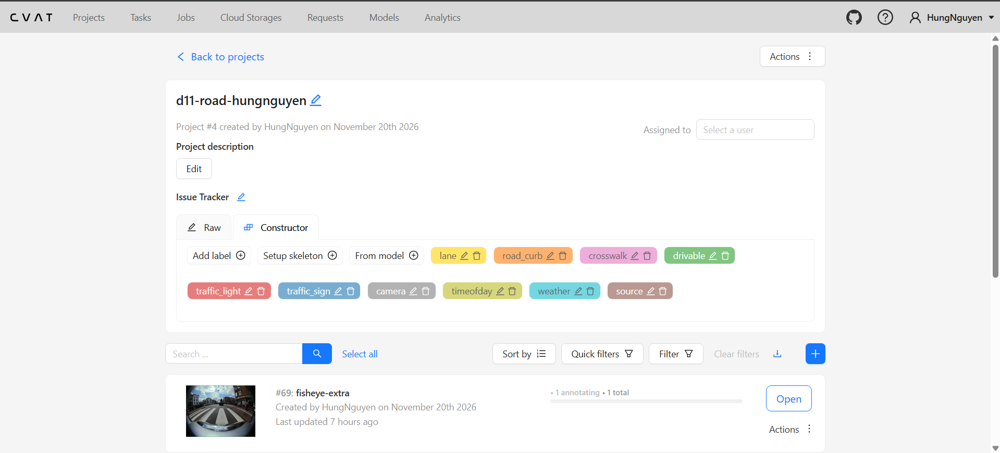
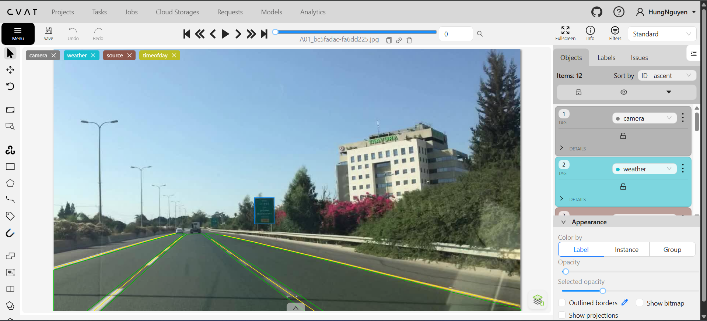
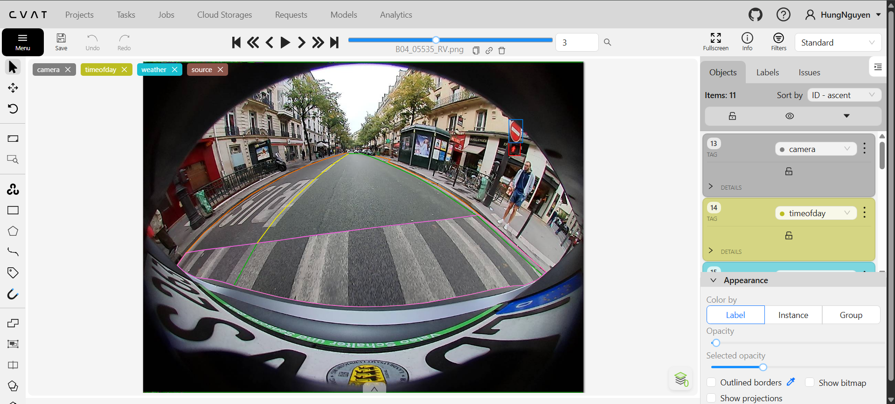
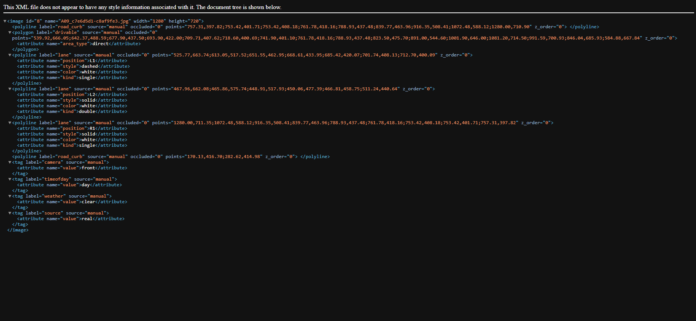

# Báo cáo cá nhân — Ngày 11

Họ tên: Nguyễn Tuấn Hưng  
Mã học viên: 2A202603199  
Phiên bản CVAT (Help → About): 2.74.1  
Guideline: Road v1.0 Lần nộp (`revision` trong manifest): 1  
Thời điểm export (ngày giờ trên CVAT): Front 2026-11-20 23:23:45; fisheye 2026-11-20 22:56:53 (UTC+07:00, theo thời gian ghi ZIP) Số lần nộp lại sau Rework: 0

## 1. Kiểm project

| Mục                   | Đúng như guideline Road v1.0? | Ghi chú                                                    |
| --------------------- | ----------------------------- | ---------------------------------------------------------- |
| 6 label, đúng kiểu    | Có                            | Đã tạo theo taxonomy Road v1.0                             |
| Thuộc tính và giá trị | Có                            | Đã tạo theo taxonomy Road v1.0                             |
| 4 tag ảnh             | Có                            | Manifest ghi đủ tag cho 12/12 ảnh front và 8/8 ảnh fisheye; hai file extra cũng có đủ 4 tag cho 4/4 ảnh mỗi task |

Cách kết thúc polyline trên bản CVAT này: Nhấn `N` theo hướng dẫn lab.  
Cách đặt tag ảnh trên bản CVAT này: Đặt tag `camera` trước, rồi thêm `timeofday`, `weather`, `source`; kiểm tra `value` trong Details.

## 2. Số lượng đã gán

| Task                         | Ảnh | lane | road_curb | crosswalk | drivable | traffic_light | traffic_sign |
| ---------------------------- | --: | ---: | --------: | --------: | -------: | ------------: | -----------: |
| front                        |  12 |   31 |        17 |         6 |       19 |            20 |           18 |
| front-extra (đã làm 4 / 4)   |   4 |   10 |         2 |         2 |        8 |            12 |           17 |
| fisheye                      |   8 |    6 |        21 |         9 |        3 |             4 |            1 |
| fisheye-extra (đã làm 4 / 4) |   4 |    0 |         2 |         3 |        2 |             1 |            0 |

## 3. Bảng ca khó

| Ảnh | Nhãn        | Phân vân giữa                 | Đã chọn                                       | Lý do                                                                       |
| --- | ----------- | ----------------------------- | --------------------------------------------- | --------------------------------------------------------------------------- |
| A05 | lane L1, R1 | Ảnh có vạch L1 và R1 không    | Không gán                                     | Không có vạch tương ứng L1/R1, nên không gán thêm để tránh thừa nhãn.       |
| A06 | lane R1     | Ảnh có vạch R1 không          | Không gán                                     | Không có vạch tương ứng R1 bên phải, nên không gán thêm để tránh thừa nhãn. |
| A09 | lane        | Chiều polyline đúng hay ngược | Đã dùng Switch orientation và Save trong CVAT | Sửa chiều để đi từ gần xe ra xa; QC1-04 không còn trong lint cuối           |

## 4. Phiếu QC 1 nhận được

Bạn kiểm lô của tôi: Đặng Minh Quân.  
Quyết định nhận được: **Release**.  
Không có lỗi nặng, không có lỗi chính vượt 5 % và không còn ca mơ hồ ảnh hưởng tới quyết định.

| Mã lỗi                                           | Số lỗi | Đồng ý?                                             | Đã sửa?       |
| ------------------------------------------------ | -----: | --------------------------------------------------- | ------------- |
| QC1-02 ở A05 và A06                              |      0 | Có — đây là ngoại lệ vì ảnh không có vạch tương ứng | Không cần sửa |
| Các mã QC1-01, QC1-03 đến QC1-12 trong mẫu 6 ảnh |      0 | Có                                                  | Không cần sửa |

## 5. Kiểm file export

| File                       | Mở lại được?      | Số shape ảnh 1 (job / file) | Số shape ảnh 2 (job / file) | Tag camera có trong XML? |
| -------------------------- | ----------------- | --------------------------- | --------------------------- | ------------------------ |
| NguyenTuanHung-front.zip   | Có, lint đọc được | A01: 8 / 8                  | A02: 7 / 7                  | Có                       |
| NguyenTuanHung-fisheye.zip | Có, lint đọc được | B01: 4 / 4                  | B02: 9 / 9                  | Có                       |
| NguyenTuanHung-front-extra.zip   | Có, lint đọc được | A13: 7 / 7                  | A14: 11 / 11               | Có                       |
| NguyenTuanHung-fisheye-extra.zip | Có, lint đọc được | B09: 5 / 5                  | B10: 1 / 1                  | Có                       |

## 6. Ảnh chụp màn hình

### 6.1. Tab Labels của Project

Ảnh chụp cấu hình các nhãn (Labels) và thuộc tính đã thiết lập cho project `d11-road-hungnguyen`.

  

### 6.2. Ảnh camera trước đã gán nhãn

Ảnh A01 minh họa kết quả gán nhãn các đối tượng gồm làn đường, vùng có thể lưu thông và biển báo.

  

### 6.3. Ảnh Fisheye đã gán nhãn

Ảnh B04 minh họa đường Polyline của lane L1 trên camera Fisheye, tập trung vào đoạn đường cong.

  

### 6.4. Kiểm tra dữ liệu XML

Trích đoạn XML của ảnh A09, thể hiện annotation sử dụng nhãn `lane` với kiểu hình học `polyline`.

  

## 7. Tự đánh giá

Lỗi cần chú ý nhất hôm nay (theo mã QC1-xx) và cách tránh ở Ngày 20: cần kiểm chặt QC1-05 khi xử lý polyline lane, đặc biệt để mỗi vạch đứt là một polyline duy nhất, đánh dấu đoạn che bằng `occluded` và không tách thành nhiều nhãn. Trong mẫu 6 ảnh đã kiểm không phát hiện lỗi nặng. Ở Ngày 20, cần rà lại `position`, chiều polyline và điểm dừng trước khi chuyển sang ảnh kế tiếp.

Nhãn lane được dùng ở đâu trong model? Lane là ground truth để huấn luyện model nhận diện vị trí vạch kẻ đường. Khi vẽ lane, thứ tự điểm quyết định đầu gần xe và đầu xa xe; nếu không dùng `Switch orientation`, pipeline tạo đích row-anchor có thể học sai thứ tự hoặc sai vị trí theo chiều sâu. Chiều lane A09 đã được sửa bằng `Switch orientation` trong CVAT để polyline đi từ gần xe ra xa, góp phần giữ dữ liệu huấn luyện nhất quán.

## 8. (Tùy chọn, buffer) Từ polyline đến đích row-anchor

| y                         |          720 |    680 |    640 |    600 |    560 |
| ------------------------- | -----------: | -----: | -----: | -----: | -----: |
| x của chúng tôi (A09, R1) | không có làn | 1227.2 | 1159.8 | 1092.5 | 1017.4 |
| x của bạn kia             | không có làn | 1232.2 | 1164.8 | 1096.5 | 1022.4 |

Trả lời 3 câu:

1. Năm số x đó chính là đích mà một model row-anchor học cho vạch này. Nếu polyline bị dừng sớm 40 px, hàng nào sẽ đổi thành "không có làn"?  
   **Trong A09 R1, điểm đầu gần xe nằm ở y=711.35, nên hàng y=720 vốn đã là "không có làn". Nếu polyline rút ngắn thêm 40 px theo trục y, đầu vạch sẽ dời lên khoảng y=671.35. Khi đó, hàng y=680 cũng sẽ đổi thành "không có làn".**

2. So với bạn được kiểm (cùng ảnh), ở hàng y=720 và y=560 hai bạn lệch nhau bao nhiêu pixel? Lệch ở hàng nào ảnh hưởng LKA nhiều hơn?  
   **Các tọa độ của bạn kiểm trong phần buffer được tự chọn để minh họa: y=720 cũng không có làn, còn tại y=560 hai bản polyline chênh 5.0 px (1022.4 − 1017.4). Hàng y=720 không thể tính độ lệch vì cả hai đều không có làn. Nếu sai lệch xảy ra ở hàng y=560, độ lệch tuy nhỏ nhưng hàng y=680 hoặc y=720 gần xe hơn thường ảnh hưởng trực tiếp tới việc xác định làn và hệ thống LKA nhiều hơn hàng y=560. Các giá trị này là dữ liệu giả định, không phải kết quả đo thực tế.**

3. Nếu polyline được vẽ từ xa về gần, tức ngược với quy tắc từ gần ra xa, cách tính trên có thay đổi không? Script nào có thể gặp khó?  
   **Cách tính theo tọa độ không thay đổi, vì `road_lab.rowanchor` vẫn có thể nội suy x tại từng hàng y dù thứ tự các điểm được đảo ngược. Tuy nhiên, `road_check lint` vẫn xác định điểm đầu sai quy tắc và báo lỗi chiều polyline theo QC1-04. Vì vậy, script tính tọa độ anchor vẫn chạy được, nhưng dữ liệu sẽ không nhất quán với guideline và dễ làm model học sai thứ tự chiều sâu.**
